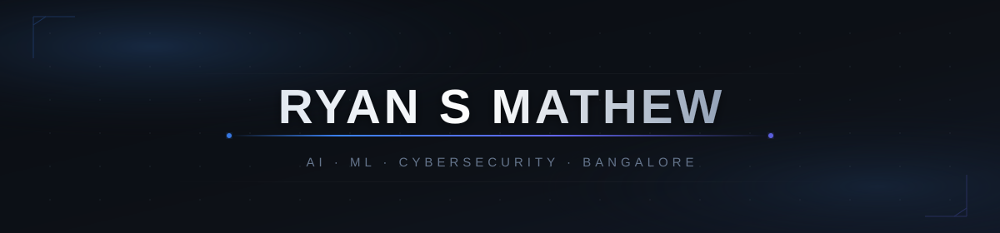

 

 

---

Final-year B.Tech student at Christ University specialising in AI & ML, with a minor in Cybersecurity. Two papers accepted and presented at international conferences this year — one on keystroke dynamics and behavioural biometrics, another on F1 race prediction using telemetry and deep learning. Outside research, I build full-stack tools, mostly things I actually want to use.

---

### Experience

**Software Development Intern — XeniaONE** *(Apr 2026 – May 2026)*  
Built a full-stack AI hotel concierge platform from scratch in 8 weeks — RAG backend grounded in hotel-specific docs, JWT-secured multi-department admin dashboard, guest-facing chat with live room service ordering. The RAG layer cut knowledge-base update time from days to minutes.

**AI & Cybersecurity Research Intern — ARDC, CHRIST University** *(May 2025 – Jul 2025)*  
Developed a keystroke dynamics pipeline (key-hold time + flight time) and trained a hybrid ensemble classifier on quantile-transformed features — 95.56% user-identification accuracy across 51 participants. This became a published paper at ICSCSP 2026.

---

### Publications

- **Enhancing User Authentication through Quantile-Transformed Keystroke Dynamics and Hybrid Ensemble Learning Approaches**  
  Ryan S Mathew, Dr. Jenefa J, Ashutosh Dash, Dr. Daniel D · *ICSCSP 2026* · Peer-reviewed, accepted, presented.

- **A Hybrid Multi-Stream Deep Learning Framework for Formula 1 Race Finishing Position Prediction Using Telemetry, Strategy, and Driver Interaction Data**  
  Ryan S Mathew, Shiju George, Aakash Lal, S Diwakar, Paul Kale · *ICCIS 2026* · Presented at BITS Pilani, Goa.

---

### Projects

#### AI / ML

| Project | About | Stack |
|---|---|---|
| [Bird Species Recognition](https://github.com/Ryan-S-Mathew123/Final-Year-Project) | Final year research project comparing classifiers across audio, image, and video. Audio pipeline uses 40-coefficient MFCCs; images go through a ConvNeXt encoder — both tested across RF, SVM, KNN, and Gradient Boosting. Flask dashboard handles batch inference, calibration reports, and CSV export. | Python · Scikit-learn · ConvNeXt · Flask |
| [Drug Information RAG Chatbot](https://github.com/Ryan-S-Mathew123/Drug-Chatbot) | End-to-end RAG pipeline with a 0.7 cosine-similarity confidence gate. Unrecognised drugs are auto-fetched from openFDA and reindexed into Chroma — no manual uploads. Next.js frontend, FastAPI backend, Ollama for local inference. | Python · FastAPI · Chroma · Sentence-Transformers · Ollama · Next.js |
| [Formal vs Informal Shoe Classifier](https://github.com/Ryan-S-Mathew123/Formal-Informal-Shoe-Prediction) | MobileNetV2-based classifier with dual input modes — image upload or live camera feed. DIP pipeline detects and draws bounding boxes around the shoe before classification. Tkinter GUI with real-time confidence scores and an evaluation dashboard. | Python · MobileNetV2 · TensorFlow · Tkinter |
| [Medical FuzzySec](https://github.com/Ryan-S-Mathew123/Medical-FuzzySec) | Adaptive medical image steganography using a 27-rule Mamdani FIS to dynamically select LSB embedding depth. Dual-layer security pipeline pairs AES-256-CBC encryption with Reed-Solomon error-correcting codes. | Python · Fuzzy Logic · AES-256-CBC · Reed-Solomon |
| [FPL Predictor](https://github.com/Ryan-S-Mathew123/Fantasy-Premier-League-Predictor) | Fantasy Premier League analytics tool that crunches player stats from the FPL API to support data-driven gameweek decisions. Models player performance trends and flags differential picks. | TypeScript · ML · FPL API |
| [Transfer Market Predictor](https://github.com/Ryan-S-Mathew123/Transfer-Market-Predictor) | Estimates football player market values using engineered features like goals/90 and assists/90, pulled via the football-data.org API. Scikit-learn regression pipeline served through a Flask web interface. | Python · Scikit-learn · Flask · Pandas |
| [F1 Telemetry Visualiser](https://github.com/Ryan-S-Mathew123/f1-race-telemetry-analysis) | Interactive race replay tool that renders live driver positions on a track, tracks tyre compounds, lap counts, and race time. Includes safety car animations with pulsing glow effects and a floating insights menu for telemetry analysis. | Python |

---

#### Full-Stack

| Project | About | Stack |
|---|---|---|
| [Streakify](https://github.com/Ryan-S-Mathew123/streakify) | Social music platform built around daily song submissions. Users build personal and group streaks, climb leaderboards, see weekly stats, and discover music through friends — all powered by the iTunes Search API. Auth, groups, and streaks managed via FastAPI + SQLAlchemy. Deployable on Render via Docker. | React · TypeScript · FastAPI · SQLAlchemy · SQLite · Tailwind |
| [XeniaONE Hotel Concierge](https://github.com/Ryan-S-Mathew123/XeniaOneSummerInternshipWork-2026) | Full hotel management platform with a 7-layer architecture. Guest chat is handled by *Nova*, a Groq Llama 3.1-backed AI with a 5-stage intent pipeline routing requests to departments. Admin dashboard includes live stats, KB editor, photo manager, and service request tracking. | Flask · SQLite · JWT · Groq AI · HTML/CSS/JS |
| [Bunk Mastr](https://github.com/Ryan-S-Mathew123/Bunk-Mastr) | Multi-user attendance tracker and predictor. Tracks classes across subjects, calculates live percentage, and tells you exactly how many more classes you can skip to stay above your threshold. Configurable semester dates and attendance targets per student. | Node.js · Express · SQLite · Vanilla JS |
| [AccurateMedicalServices Website](https://github.com/Ryan-S-Mathew123/AccurateMedicalServices-Website) | Full website built for a medical services company. Clean TypeScript-based frontend with service listings, contact flow, and responsive layout designed for a professional audience. | TypeScript |

---

#### Cybersecurity

| Project | About | Stack |
|---|---|---|
| [Medical FuzzySec](https://github.com/Ryan-S-Mathew123/Medical-FuzzySec) | Hides encrypted patient data inside medical images using adaptive LSB steganography. The Mamdani FIS adjusts embedding depth based on image complexity — lower distortion, harder to detect. AES + Reed-Solomon ensures the hidden data survives minor image tampering. | Python · Fuzzy Logic · AES-256-CBC · Reed-Solomon |

---

### Skills

**Languages** — Python · TypeScript · JavaScript · Java · C · SQL · Bash · HTML/CSS  
**Frameworks** — FastAPI · Flask · Next.js · Node.js · React  
**AI / ML** — Scikit-learn · PyTorch · TensorFlow · NLP · RAG Pipelines · Sentence Transformers · Fuzzy Logic · Chroma · ConvNeXt  
**Cybersecurity** — Penetration Testing · Behavioural Biometrics · IDS/IPS · Packet Analysis · Disk Forensics · Kali Linux · Burp Suite · Wireshark  
**Tools** — Git · Docker · Linux · Jupyter · Ollama · VS Code · Figma

---

CGPA: 8.16 / 10 · Christ (Deemed to be University) · Aug 2023 – May 2027

